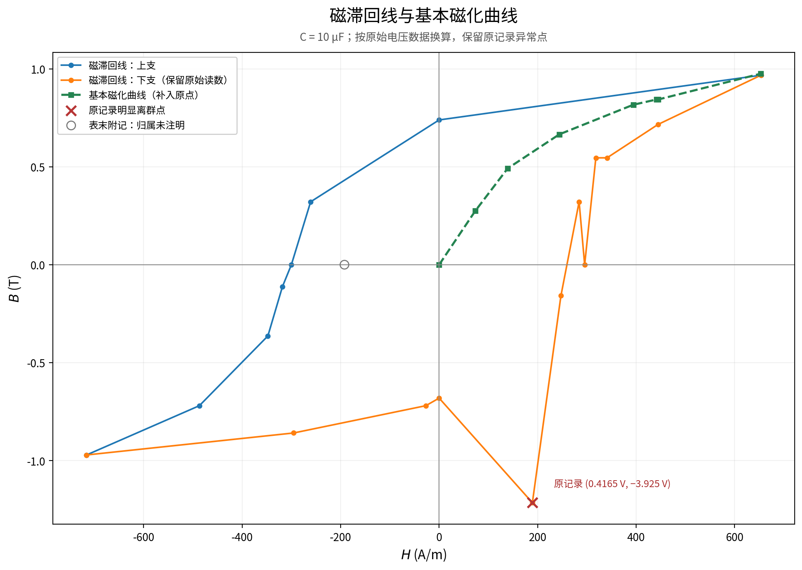

# 铁芯磁滞回线与基本磁化曲线

## 1. 换算公式

已知：R₁ = 5 Ω，R₂ = 10 kΩ，C = 10 μF，N = 500，n = 1000，L = 0.22 m，A = 3.23×10⁻⁴ m²。

X、Y 已记录为电压，因此直接使用电压换算，不再乘示波器格值系数。

$$H=\frac{N}{LR_1}X=454.545X\quad(\mathrm{A/m})$$

$$B=\frac{R_2C}{nA}Y=\frac{10^4\times10\times10^{-6}}{1000\times3.23\times10^{-4}}Y=0.309598Y\quad(\mathrm{T}).$$

电容 C = 10 μF 来自补充计算照片；截面积采用参数照片的 3.23×10⁻⁴ m²。

例如，X = 0.16150 V、Y = 0.88750 V 时：H = 454.545×0.16150 = 73.41 A/m，B = 0.309598×0.88750 = 0.274768 T。

## 2. 基本磁化曲线数据

| 序号 | X / V | Y / V | H / (A·m⁻¹) | B / T |
|---:|---:|---:|---:|---:|
| 1 | 0.16150 | 0.88750 | 73.41 | 0.274768 |
| 2 | 0.30600 | 1.58750 | 139.09 | 0.491486 |
| 3 | 1.43650 | 3.15000 | 652.95 | 0.975232 |
| 4 | 0.86700 | 2.63750 | 394.09 | 0.816563 |
| 5 | 0.53700 | 2.15000 | 244.09 | 0.665635 |
| 6 | 0.97125 | 2.72500 | 441.48 | 0.843653 |
| 7 | 0.97875 | 2.72500 | 444.89 | 0.843653 |

## 3. 磁滞回线数据

| 序号 | X / V | Y / V | H / (A·m⁻¹) | B / T |
|---:|---:|---:|---:|---:|
| 1 | -1.57500 | -3.13750 | -715.91 | -0.971362 |
| 2 | 1.43750 | 3.12500 | 653.41 | 0.967492 |
| 3 | -0.65000 | -2.77500 | -295.45 | -0.859133 |
| 4 | 0.75000 | 1.76250 | 340.91 | 0.545666 |
| 5 | -0.70000 | -0.36250 | -318.18 | -0.112229 |
| 6 | 0.70000 | 1.76250 | 318.18 | 0.545666 |
| 7 | -0.66000 | 0.00000 | -300.00 | 0.000000 |
| 8 | 0.65000 | 0.00000 | 295.45 | 0.000000 |
| 9 | 0.00000 | -2.20000 | 0.00 | -0.681115 |
| 10 | 0.00000 | 2.38750 | 0.00 | 0.739164 |
| 11 | -0.57400 | 1.03750 | -260.91 | 0.321207 |
| 12 | 0.62525 | 1.03750 | 284.20 | 0.321207 |
| 13 | -0.76500 | -1.17500 | -347.73 | -0.363777 |
| 14 | 0.41650 | -3.92500 | 189.32 | -1.215170 |
| 15 | 0.54400 | -0.51250 | 247.27 | -0.158669 |
| 16 | -1.07100 | -2.32500 | -486.82 | -0.719814 |
| 17 | -0.05950 | -2.32500 | -27.05 | -0.719814 |
| 18 | 0.97750 | 2.31250 | 444.32 | 0.715944 |

表格保留照片的原始排列顺序；作图按两支回线连接。上支使用第 1、16、13、5、7、11、10、2 点；下支使用第 1、3、17、9、14、15、12、8、6、4、18、2 点。照片没有标注测量方向，此分支连接按各点位置整理。

## 4. 剩磁与矫顽力

H = 0 时，读到 Y₊ = 2.38750 V、Y₋ = −2.20000 V，故

$$B_r^+=0.739164\,\mathrm{T},\qquad B_r^-=-0.681115\,\mathrm{T}.$$

取两侧绝对值的平均值：

$$\boxed{B_r=\frac{|B_r^+|+|B_r^-|}{2}=0.710139\,\mathrm{T}}.$$

B = 0 时，回线区直接记录 X₋ = −0.66000 V、X₊ = 0.65000 V，故

$$H_c^-=-300.00\,\mathrm{A/m},\qquad H_c^+=295.45\,\mathrm{A/m},$$

$$\boxed{H_c=\frac{300.00+295.45}{2}\approx297.73\,\mathrm{A/m}}.$$

## 5. 合并图及读数说明

- 所有 mV 已换成 V；基本磁化曲线按 H 从小到大连线，并补入理论原点。
- 基本磁化表第三个 X 按手写的 1.4365 V 录入。
- 回线第 14 点 (0.41650 V, −3.92500 V) 比所记录的负端点 Y = −3.13750 V 还低，已保留并标红；第 12、8 点也造成局部折返，因此采用原始折线，不作平滑或改数。这些点不参与本次截距计算。
- 基本磁化表末另记 (−0.423 V, 0)，归属未注明，换算为 H = −192.27 A/m、B = 0，图中单独空心标出；矫顽力采用明确写在磁滞回线区的两个零点。
- 补图的示例取 Uc = 1.4 V、UR₁ = 0.3 V、A = 3.2×10⁻⁴ m²，与原始记录的截距及参数不同，未替换原数据。该示例的剩磁为 0.4375 T；其矫顽力算式 500×0.3/(0.22×5) 应得 136.36 A/m，图中写的 90.90 A/m 为算术错误。
